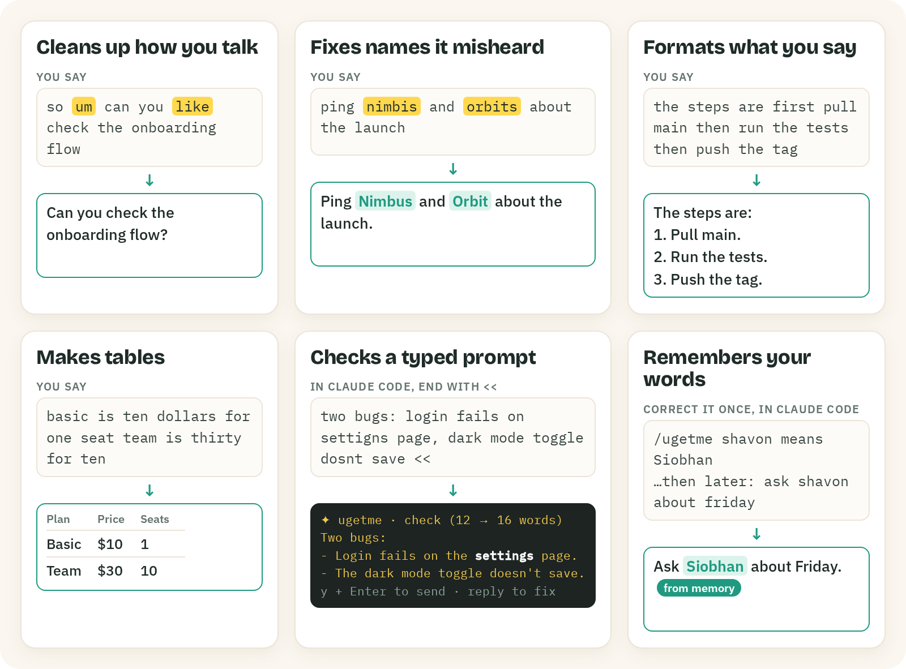
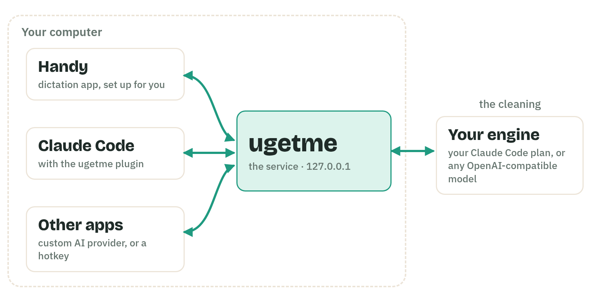
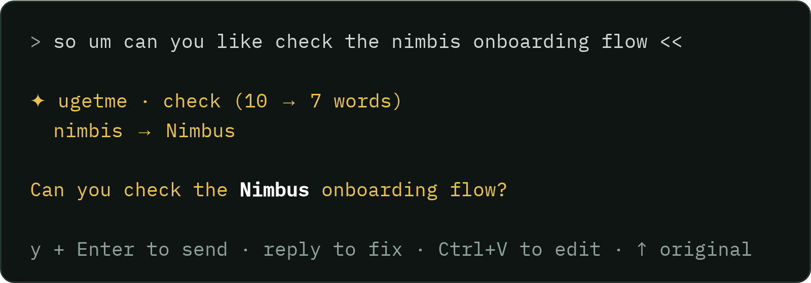

<p align="center">
  <picture>
    <source media="(prefers-color-scheme: dark)" srcset="docs/media/banner-dark.png">
    
  </picture>
</p>

<p align="center">
  <a href="https://github.com/hassan-mir/ugetme/actions/workflows/test.yml"></a>
  
  
  
</p>

<p align="center">
  <a href="docs/media/ugetme-launch.mp4">Video</a> ·
  <a href="#quick-start">Install</a> ·
  <a href="https://paypal.me/infernoswif">Donate</a> ·
  <a href="#features">Features</a> ·
  <a href="#configuration">Configuration</a> ·
  <a href="docs/guide.md">Guide</a>
</p>

**ugetme** ("you get me") is an AI cleanup layer for the dictation you already use. You speak naturally; it removes the "um"s and false starts, fixes the names it misheard, turns steps into lists and comparisons into tables, and remembers how you speak. Then the clean text is pasted.

- **For** anyone who dictates into Claude Code, chat, email or any other app, with [Handy](https://github.com/cjpais/Handy) or another dictation app.
- **Runs as a small service on your computer and cleans with the Claude Code account you already have.** No new subscription and no API key.
- **Free and open source** (MIT). The cleaning uses your own Claude Code plan. It can also use an OpenAI API key, or a local model with Ollama.

<p align="center">
  <a href="docs/media/ugetme-launch.mp4"></a>
  <br><sub>What you say, and what your app gets. <a href="docs/media/ugetme-launch.mp4">Watch the 87-second video, with sound.</a></sub>
</p>

## Why I built this

I used Wispr Flow and loved the AI cleanup, but I did not want to pay for one more subscription. I switched to [Handy](https://github.com/cjpais/Handy), a free, open-source dictation app that is excellent at transcription. Its own AI step is experimental and needs an API key or a local model, and it does not see my word list or what I am working on.

I already pay for Claude Code. So ugetme uses that account, on my own computer, to clean what I say, with my word list, my project names and my current Claude Code conversation as context. It works in Handy, in Claude Code, and in any other app.

## Quick start

### 1. Get a dictation app

ugetme does not hear you. It cleans the text that a dictation app gives it.

- **No dictation app yet?** Try [Handy](https://handy.computer). It is free, open source, and runs on your computer, and ugetme setup configures it for you. Install it as the table below shows.
- **Already use one?** Keep it. ugetme works with any app that has a custom OpenAI-compatible provider (OpenWhispr, Whispering, VoiceInk and more), and with any other dictation, such as Win+H or macOS Dictation, through `ugetme clipboard`. See [other apps](docs/guide.md#using-it-from-other-tools), and go to step 2.

| System | Install Handy |
|---|---|
| macOS | `brew install --cask handy`, or the download on [handy.computer](https://handy.computer) |
| Windows (also for WSL) | `winget install cjpais.Handy`, or the download on [handy.computer](https://handy.computer) |
| Linux | The `.deb`, `.rpm` or `.AppImage` from [Handy's releases](https://github.com/cjpais/Handy/releases) |

Open Handy once and do its first steps (choose a speech model; on macOS, allow the Microphone and Accessibility permissions). Then quit Handy (tray icon, then Quit), so that ugetme setup can change its settings.

For the speech model, I recommend **Parakeet V3** (at the time of writing, October 2026): it is fast and accurate, and it runs well without a GPU. It covers English and 24 other European languages; for other languages, choose a Whisper model.

### 2. Install ugetme

You need:
- [uv](https://docs.astral.sh/uv/) (it brings its own Python), or pipx with Python 3.9 or later;
- [Claude Code](https://claude.com/claude-code), logged in. This is the main way: ugetme cleans with your Claude Code plan. Other options: an OpenAI API key, or a local model with [Ollama](https://ollama.com) (see [Questions](#questions)).

**The easy way: let Claude Code set it up.** Run this in a terminal:

```sh
claude "Set up ugetme for me: fetch and follow https://raw.githubusercontent.com/hassan-mir/ugetme/main/INSTALL.md"
```

Claude Code installs ugetme, asks you a few questions (which login, which project folders, Handy, the mode, start at login), sets up the plugin and cleans a test sentence. In a Claude Code session that is already open, paste the same sentence as a prompt.

**By hand:**

```sh
uv tool install git+https://github.com/hassan-mir/ugetme    # or: pipx install git+https://github.com/hassan-mir/ugetme
ugetme setup
```

If your shell does not find `ugetme` afterwards, run `uv tool update-shell` and open a new terminal. If you use Handy, quit it before setup. Then, in Claude Code, add the plugin (once for each Claude login you use):

```text
/plugin marketplace add hassan-mir/ugetme
/plugin install ugetme@ugetme
```

Setup finds Handy and sets it up for you, with a backup: it points Handy's AI step ("post-processing") at ugetme. If you install Handy later, open it once, quit it, and run `ugetme handy setup`.

### 3. Choose how it works

Setup asks how you want to use ugetme. Pick `auto` if you want clean text and do not want to think about it. Pick `check` if you dictate into Claude Code and want to read every prompt before it goes.

| Mode | Handy's main hotkey | Claude Code |
|---|---|---|
| `auto` (default) | Pastes clean text, with no check | Add `<<` to a prompt when you want a check |
| `check` | Pastes your own words | Checks every prompt of 5 words or more, with no `<<` |
| `manual` | Pastes your own words | Checks only a prompt with `<<` |

In every mode, Handy's second hotkey does the opposite of the main one, so you always have both. To change the mode later, quit Handy and run `ugetme mode check` (or `auto`, or `manual`).

## How it compares

ugetme does not do speech-to-text. It adds the AI step to an app that does, such as Handy. Facts are from each product's own site on 1 October 2026; prices change, so check before you choose.

| | **ugetme** + Handy | Wispr Flow | Superwhisper | Handy alone | OpenWhispr | Claude Code `/voice` |
|---|---|---|---|---|---|---|
| Price | Free with your own Claude Code plan (it uses that plan's usage), or with a free local model | Free up to 2,000 words a week on desktop; Pro $12 a month yearly or $15 monthly | Free with small local models; Pro $8.49 a month | Free | Free with local models or your own key; Pro $8 a month | Included in a Claude plan |
| Open source | Yes (MIT) | No | No | Yes (MIT) | Yes (MIT) | No |
| Speech-to-text | On your computer (Handy) | Cloud | On your computer, or cloud in Pro | On your computer | Your choice | Cloud |
| AI cleanup with | Your Claude Code account, or any local or OpenAI-compatible model | Their service | Their cloud models or your own key (Pro); small local models free | Your own API key or a local model (experimental) | Your own key, a local model or their service | No cleanup step |
| Learns your words | Yes, from your corrections | Yes | Custom vocabulary | Custom word list | Yes | No |
| Knows your Claude Code conversation | Yes | No | No | No | No | Project name and branch only |
| Platforms | macOS, Linux, Windows | Mac, Windows, iOS, Android | Mac, Windows, iOS, Android | macOS, Linux, Windows | macOS, Linux, Windows | Claude Code CLI and VS Code on your own computer (not SSH or web) |

Pick Wispr Flow or Superwhisper if you want one polished app with nothing to set up. Pick ugetme if you already pay for Claude Code, want the service on your own computer (with a local model if you choose), or want your dictation to know your projects.

## Features

<p align="center"></p>

**Cleaning**
- Removes filler words ("um", "like"), repeated words and false starts. When you change your mind mid-sentence, it keeps your final version.
- Fixes names it misheard, with your word list, the names of your projects and your recent Claude Code conversation.
- Understands spelled-out words: "slow, S-L-O-W" becomes "slow".
- Turns steps into a numbered list, several items into bullets, and a comparison into a table.
- Keeps code, commands, file paths and numbers as you said them. Pasted code blocks and logs are held back from the AI and come back unchanged.
- Keeps your meaning: "I think" and "maybe" stay, questions stay questions, and the prompt tells it never to answer your text or follow instructions in it.

**Memory**

The memory is a small file on your computer. ugetme sends it to the model (Claude Code, by default) with each cleanup, so the model spells your names your way.

- Learns a name when you correct it once: from your edit in Claude Code, or with `ugetme learn` anywhere.
- Keeps words exactly as you say them, follows your style notes, and knows the names of your projects.
- The memory is a plain file that you can read and edit. `ugetme review` and `ugetme forget` undo a wrong fix.

**Where it works**
- [Handy](https://github.com/cjpais/Handy), the free, open-source dictation app. Install it yourself; `ugetme setup` then finds it and configures it for you, with a backup. Quit Handy first.
- Any app with a custom OpenAI-compatible provider: OpenWhispr, Whispering, VoiceInk and more.
- Any other dictation, such as Win+H or macOS Dictation, through a clipboard hotkey (`ugetme clipboard`).
- Claude Code, with the plugin: context from your conversation, learning from your edits, the `/ugetme` command, and a check before you send: on a prompt with `<<`, or on every prompt in mode `check`.

**Private and safe**
- Runs on your computer, on `127.0.0.1`. Every request except the health check needs a token. Your text goes only to your engine.
- Cleans with your installed Claude Code (`claude -p`), or with any OpenAI-compatible model, local ones too. It supports several Claude logins.
- If anything fails, you get your own words back. Nothing is lost.
- Made for macOS, Linux, Windows and WSL, with the Python standard library only. It is tested most on Linux and WSL.

## How it works

<p align="center">
  <picture>
    <source media="(prefers-color-scheme: dark)" srcset="docs/media/arch-dark.png">
    
  </picture>
</p>

1. You dictate in Handy, or in any app, or you type a prompt in Claude Code that starts or ends with `<<` (or any prompt, in mode `check`).
2. The app sends your words to ugetme, a small service on your computer.
3. ugetme adds what it knows (your word list, your projects, your recent conversation) and cleans the text with your engine.
4. The clean text is pasted where your cursor is. In Claude Code, you check it first.

One service does all the cleaning, so a word you teach through one app is known by all of them.

## Use it

**With Handy:** press the ugetme hotkey (your main hotkey in mode `auto`, the second one in the other modes), speak, and release it (or press it again, in Handy's toggle mode). A few seconds later the clean text is pasted. The other hotkey gives you your own words.

You choose the keys in Handy's settings: the shortcuts for **Transcribe** and **Transcribe with Post-Processing**. ugetme runs on Transcribe with Post-Processing (in mode `auto`, setup puts your main key there), so you can change that key to any combination you like. `ugetme handy status` shows which key runs ugetme.

**With other apps:** point any app that has a custom OpenAI-compatible provider at `http://127.0.0.1:7337/v1`, with the token from `~/.ugetme/token`. For any other dictation, copy the text and run `ugetme clipboard` from a hotkey. The [guide](docs/guide.md#using-it-from-other-tools) lists the apps and the hotkey recipes.

**In Claude Code:** add `<<` at the start or end of a prompt and press Enter (in mode `check`, just press Enter). ugetme shows the clean version and the words it fixed. `y` + Enter sends it. With `<<`, your original is never sent.

<p align="center"></p>

**Teach it a word:**

```sh
ugetme learn nimbis Nimbus              # in Claude Code: /ugetme nimbis means Nimbus
ugetme learn "cloud code" "Claude Code"
ugetme keep kubectl                     # never change this word
ugetme forget Nimbus                    # undo
```

When you correct a name in Claude Code before you send, ugetme learns it by itself and tells you.

## Configuration

See and change every setting with `ugetme config`:

```sh
ugetme config                 # show all settings, with their choices
ugetme mode check             # check every prompt in Claude Code (quit Handy first)
ugetme config model opus      # clean with a different Claude model
ugetme config context light   # send less of your conversation
ugetme config log off         # keep no log of your cleanups
```

The settings are in `~/.ugetme/config.json`. Most changes apply at once.

| Setting | Default | What it does |
|---|---|---|
| `mode` | `auto` | How ugetme works with Handy and Claude Code: `auto`, `check` or `manual` (see [Choose how it works](#3-choose-how-it-works)). Change it with `ugetme mode`, which also moves the Handy hotkey |
| `engine` | `claude` | `claude` (your installed Claude Code) or `openai` (any OpenAI-compatible API) |
| `model` | `sonnet` | The Claude model that cleans your text |
| `effort` | `low` | The Claude effort level; lower is faster |
| `openai.base_url`, `openai.model`, `openai.api_key` | empty | The OpenAI-compatible engine: OpenAI itself (`https://api.openai.com/v1` and your API key), or a local model, for example Ollama at `http://localhost:11434/v1` with no key |
| `context` | `balanced` | How much of your Claude Code conversation goes with a cleanup: `none`, `light`, `balanced`, `full` or `custom` |
| `custom.turns`, `custom.last_reply`, `custom.file_names`, `custom.project_outline` | 6, on, on, on | What `custom` sends: the number of recent turns, Claude's last reply, the file names Claude used, and the project's folder list |
| `live_context_minutes` | `0` | For Handy and other apps: how old your latest Claude Code session may be to be used. `0` means no limit |
| `timeout_s` | `45` | Seconds before a cleanup gives up and returns your own words (80 at most) |
| `check_highlight` | `white` | How the check marks fixed words: `white`, `inverse` (for light terminals) or `none` |
| `log` | `on` | Keep a private log of recent cleanups, for `ugetme review` |
| `port` | `7337` | The local port. `ugetme config port <n>` stops the old service; then run `ugetme ensure` and `ugetme handy setup` |
| `claude_config_dir`, `claude_bin`, `env_path` | set by setup | Which Claude login cleans your text, where `claude` is, and its PATH. See the [guide](docs/guide.md#settings) |
| `engine_env` | empty | Extra environment variables for the engine. Edit `~/.ugetme/config.json` to set them |

Other settings have their own commands: `ugetme trust <folder>` (use the conversations of another Claude login), `ugetme scan <folder>` (where your projects are), `ugetme autostart on|off` and `ugetme handy setup`.

**What it remembers** is in `~/.ugetme/vocab.md`, a plain file in four parts. You can edit it by hand:

```markdown
# Terms
- Nimbus (heard: "nimbis", "nimbos")

# Style
- Prefer numbered lists.

# Keep
- kubectl

# Projects (auto)
- nimbus-api
```

A project can add its own words in `.claude/ugetme.md`. The [guide](docs/guide.md) explains every setting, the context presets and the learning rules in detail.

## Commands

| Command | What it does |
|---|---|
| `ugetme setup` | Guided setup: login, projects, mode, autostart, Handy, a test |
| `ugetme mode [auto\|check\|manual]` | Show the modes, or change the mode and move the Handy hotkey to match |
| `ugetme status` | The service, engine, mode, context, word list, autostart and Handy, with a warning when something is off |
| `ugetme config [key [value]]` | Show or change settings |
| `ugetme learn <heard> <meant>` / `keep` / `forget` / `review` | Teach, keep, undo and review words |
| `ugetme clean <text>` / `clipboard` | Clean text from the command line, or the text on the clipboard |
| `ugetme trust` / `untrust` | Use (or stop using) the conversations of another Claude login |
| `ugetme style <note>` / `scan [folder ...]` / `tidy` | Add a style note, read your project names again, merge duplicate words |
| `ugetme handy setup` / `undo` / `status` | Set up Handy (with a backup), restore the backup, or check it |
| `ugetme autostart on` / `off` / `status` | Start the service when you log in |
| `ugetme restart` / `stop` / `ensure` / `test` | Restart, stop or start the service, or clean a sample sentence |

`ugetme --help` lists them all. In Claude Code, `/ugetme` runs most of these, for example `/ugetme status` or `/ugetme nimbis means Nimbus`.

## Questions

**Does ugetme turn speech into text?** No. A dictation app does that, for example Handy. ugetme cleans the text before the app pastes it. With no dictation app, you can still clean typed text with `<<` in Claude Code, or any copied text with `ugetme clipboard`.

**Do I need Handy?** No. Handy is the app I use, and the only one that setup configures for you. Any app with a custom OpenAI-compatible provider works, and any other dictation works through `ugetme clipboard`. See [other apps](docs/guide.md#using-it-from-other-tools).

**How much of my Claude plan does a cleanup use?** One short `claude -p` call with Sonnet: about 1,000 input tokens for the instructions, plus your text and context. The output is about as many tokens as your text, because the clean text comes back in full. The default `balanced` context adds up to about 3,000 tokens of conversation (6 turns), and `full` up to about 10,000. To send less, run `ugetme config context light` or `none`.

**How fast is it?** About 3 seconds with Sonnet. If a cleanup takes longer than `timeout_s` (45 seconds) or fails, you get your own words.

**Can I use it without Claude Code?** Yes, with any OpenAI-compatible model: OpenAI itself, or a local model with Ollama or LM Studio. Small local models (3B to 8B) remove filler words, but they rarely make lists or tables, and they sometimes follow instructions inside your text (I tried 3B and 7B models). Use a large model for results like Claude's.

**Which languages?** It writes in the language you speak. I tried English, Spanish and French.

**Can I change how it writes?** Add style notes (`ugetme style "Use British spelling"`), teach words (`ugetme learn`), or give a project its own word list (`.claude/ugetme.md`). A setting for your own prompt is planned.

## Privacy and your Claude plan

ugetme sends your text only to your engine: your installed Claude Code, or the model you configured. It keeps its files in `~/.ugetme`, readable only by you: your settings, your word list, and a log of recent cleanups that you can turn off. With the Claude engine, your Claude plan's terms and usage limits apply. See [SECURITY.md](SECURITY.md) to report a problem.

## What's next

These are the things I plan to work on next. They have no dates yet, and what users ask for decides the order. Tell me what you need in [Discussions](https://github.com/hassan-mir/ugetme/discussions).

- Speech-to-text built in, so you need no separate dictation app.
- A setting for your own cleanup prompt and styles for each app.
- More AI providers, for example a ChatGPT login (today: Claude Code, an OpenAI-compatible API key, or a local model).
- Packaged installers, and a small status icon in the menu bar or tray.
- A hosted version, for people who cannot run it on their own computer.

## Support and contact

- **Donate:** through [PayPal](https://paypal.me/infernoswif), if you like.
- **Sponsorship, a hosted version, or help for your team:** start a thread in [Discussions](https://github.com/hassan-mir/ugetme/discussions).
- **Bugs:** open an [issue](https://github.com/hassan-mir/ugetme/issues). Security problems: see [SECURITY.md](SECURITY.md).

## Thanks

- [Handy](https://github.com/cjpais/Handy) by CJ Pais: free, open-source, local dictation. ugetme exists because Handy is so good.
- [Claude Code](https://claude.com/claude-code), which does the cleaning, and the dictation apps that let you plug in your own provider: OpenWhispr, Whispering and VoiceInk.

## More

- [The guide](docs/guide.md): every step of setup, context, learning, all commands and settings, other apps, troubleshooting, [update](docs/guide.md#update) and [uninstall](docs/guide.md#uninstall).
- [Contributing](CONTRIBUTING.md): the tests use the standard library only (`python3 -m unittest discover -s tests`).
- [Changelog](CHANGELOG.md)

## License

[MIT](LICENSE)
