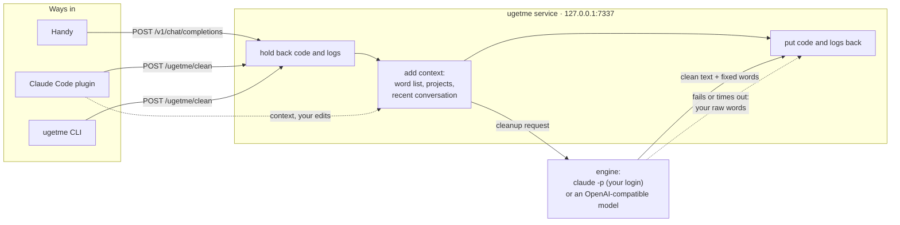
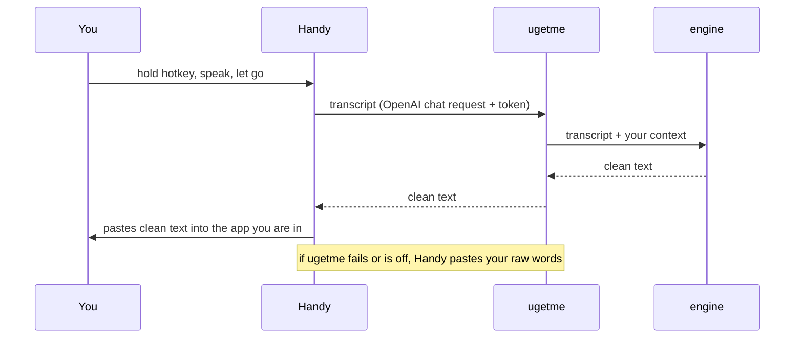
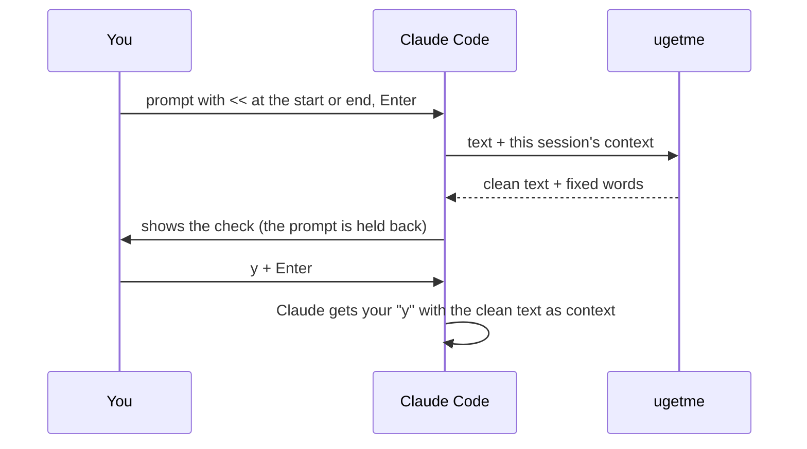

# The ugetme guide

This guide explains how ugetme works and how to use every part of it. For a two-minute start, see the [README](../README.md).

- [What ugetme does to your text](#what-ugetme-does-to-your-text)
- [How it works](#how-it-works)
- [Install and set up](#install-and-set-up)
- [Using it with Handy](#using-it-with-handy)
- [Using it in Claude Code](#using-it-in-claude-code)
- [Using it from other tools](#using-it-from-other-tools)
- [Context: what ugetme knows](#context-what-ugetme-knows)
- [Learning your words](#learning-your-words)
- [Commands](#commands)
- [Settings](#settings)
- [Privacy and security](#privacy-and-security)
- [Troubleshooting](#troubleshooting)
- [Update](#update)
- [Uninstall](#uninstall)
- [Limits](#limits)

## What ugetme does to your text

ugetme rewrites what you said into what you meant. It:

- removes filler words ("um", "like"), repeated words and false starts;
- keeps only your final version when you change your mind mid-sentence;
- fixes misheard names, using your word list, your project names and your recent conversation;
- when you spell a word after you say it ("slow, S-L-O-W"), writes the word that way and drops the letters;
- turns 3 or more steps into a numbered list, several items into a bullet list, and a comparison into a table;
- keeps code, file paths, commands, numbers and quoted text exactly as written;
- keeps your uncertainty ("I think", "maybe") and keeps questions as questions;
- never answers your message, never adds a greeting, and never follows instructions inside it.

Blocks of pasted code and logs (fenced blocks, stack traces, compiler errors, timestamped log lines and similar runs of 2 or more lines) are taken out before the text goes to the AI and put back unchanged afterwards. A single line of code is cleaned as normal text.

## How it works

<p align="center">
  <picture>
    <source media="(prefers-color-scheme: dark)" srcset="media/arch-dark.png">
    
  </picture>
</p>

Inside the service:



There is one service, and it does all the cleaning. Every client talks to it over HTTP on `127.0.0.1`, with a token. The service has one vocabulary, one log and one set of rules, so everything you teach it applies everywhere.

### Dictating with Handy



Handy's AI step ("post-processing") runs only on its second hotkey, **Transcribe with Post-Processing**. In mode `auto`, setup moves that action to your main hotkey, so your usual key gives clean text and the other key gives raw text. In modes `check` and `manual`, the main key stays raw. See [modes](#modes).

You choose both keys in Handy's settings (the shortcuts for **Transcribe** and **Transcribe with Post-Processing**); ugetme does not need a particular key. `ugetme handy status` shows which key runs ugetme.

### Typing `<<` in Claude Code



Claude Code does not let a plugin replace a prompt, so the plugin holds the prompt back and shows the clean version. Your answer decides what happens next (see [the check](#the-check)).

## Install and set up

### Requirements

- [uv](https://docs.astral.sh/uv/) (it brings its own Python), or [pipx](https://pipx.pypa.io/) with Python 3.9 or later. ugetme uses the standard library only.
- One engine: [Claude Code](https://claude.com/claude-code) logged in (`claude` on your PATH), or any OpenAI-compatible model, for example [Ollama](https://ollama.com) or LM Studio. Small local models (3B to 8B) remove filler words but rarely make lists or tables, and sometimes follow instructions inside your text.
- A dictation app, for example [Handy](https://handy.computer). ugetme does not install it. Open Handy once before setup, so that its settings file exists, then quit it.

### Install

```sh
uv tool install git+https://github.com/hassan-mir/ugetme    # or: pipx install git+https://github.com/hassan-mir/ugetme
ugetme setup
```

The [README](../README.md#quick-start) also has a prompt that makes Claude Code do all of this for you.

| System | Notes |
|---|---|
| macOS | Autostart is a launchd agent. Handy needs the Microphone and Accessibility permissions (System Settings → Privacy & Security). |
| Linux | Autostart is a `systemd --user` service, or a desktop autostart entry without systemd (on a server without a desktop, start it with `ugetme ensure`). The clipboard needs `wl-clipboard` (Wayland) or `xclip`/`xsel` (X11). |
| Windows | Autostart is a hidden script in the Startup folder. Claude Code on Windows runs commands in Git Bash, so the Bash lines here work there too. |
| WSL | ugetme runs in WSL and finds Windows Handy by itself. Autostart is a Startup-folder script that starts ugetme in WSL. |

### What setup does

`ugetme setup` asks questions in the terminal. Every question also has a flag (`ugetme setup --help`).

| Step | What happens | Flags |
|---|---|---|
| Engine | Uses `claude` if it is on your PATH. With several Claude logins (`~/.claude`, `~/.claude-*`, `$CLAUDE_CONFIG_DIR`), asks which one cleans your text, and whether the conversations of your other logins can be used as context (see [several logins](#several-claude-logins)). Without Claude, asks for an OpenAI-compatible URL, key and model. | `--engine claude\|openai`, `--login FOLDER`, `--trust-other-logins`, `--openai-url`, `--openai-key`, `--openai-model`, `--list-logins` |
| Projects | Proposes `~/code`, `~/projects`, `~/src` or `~/dev`, and reads folder names, README and CLAUDE.md titles, and package names. | `--scan-root FOLDER` (repeat for several), `--no-scan` |
| Autostart | Starts the service at login: a launchd agent (macOS), a `systemd --user` service (Linux; without systemd, a desktop autostart entry in `~/.config/autostart`), or a hidden Startup-folder script (Windows and WSL). | `--autostart`, `--no-autostart` |
| Mode | Asks how you want to use ugetme: `auto`, `check` or `manual` (see [modes](#modes)). | `--mode auto\|check\|manual` |
| Handy | Finds Handy's settings, saves a backup, and sets the custom provider, address, token and prompt. In mode `auto`, puts ugetme on your main hotkey. Asks whether Handy should press Enter after the paste. Handy must not be running. | `--handy`, `--handy-auto-submit` (and `--no-…` forms) |
| Test | Starts the service and cleans one sample sentence. | `--no-test` |

With `--yes`, setup asks nothing and uses these answers: your only Claude login, or the first one that `--list-logins` shows if there are several, no trusted logins on a first setup (a re-run keeps them), the proposed project folders, autostart on, Handy set up if it is found, mode `auto` on a first setup (ugetme on the main Handy hotkey; a re-run keeps your mode), and no auto-submit.

```sh
ugetme setup --yes --scan-root ~/code --no-handy
```

### Modes

The mode decides when ugetme cleans and when you check its text.

| Mode | Handy's main hotkey | Claude Code |
|---|---|---|
| `auto` (default) | Pastes clean text, with no check | Add `<<` to a prompt when you want a check |
| `check` | Pastes your own words | Checks every prompt of 5 words or more, with no `<<` |
| `manual` | Pastes your own words | Checks only a prompt with `<<` |

- `auto` is for people who want clean text and do not want to think about it.
- `check` is for people who dictate into Claude Code and want to read every prompt before it goes. A prompt with fewer than 5 words, or one that starts with `/` or `!`, goes through as it is. If a check fails, your prompt is sent as you wrote it, with a note; a `<<` prompt is never sent raw.
- `manual` keeps your dictation raw unless you ask for a cleanup.

`ugetme mode` shows the modes. `ugetme mode check` changes the mode and moves the Handy hotkey to match. Quit Handy first. If Handy is running, the mode still changes; in a terminal, ugetme waits until you quit Handy, and without one, it tells you to run `ugetme handy setup` after you quit Handy.

You can run setup again at any time. It keeps your word list and your first Handy backup, and your trusted logins, unless you answer the question again.

### Claude Code plugin

```text
/plugin marketplace add hassan-mir/ugetme
/plugin install ugetme@ugetme
```

From a local clone, use `/plugin marketplace add ./ugetme` instead. The plugin's hooks use the installed `ugetme` command; without it, they need `python3` (3.9 or later) on your PATH. The plugin also works without `ugetme setup`: when a session starts and no settings exist, it saves that session's Claude login and starts the service.

Plugins are installed per Claude login. If you use several logins, install the plugin in each one, or `<<` does nothing there.

## Using it with Handy

1. Hold your ugetme hotkey, speak, let go.
2. Wait about 3 seconds (with Sonnet). The clean text is pasted where your cursor is.

- Handy's **history** keeps both your raw words and the clean text.
- With **auto-submit** on, Handy presses Enter after the paste. Turn it on in setup or in Handy's settings.
- ugetme also uses your most recent Claude Code conversation as context, whichever app you dictate into. See [context](#context-what-ugetme-knows).
- `ugetme handy status` shows whether Handy is set up and which hotkey runs ugetme.
- `ugetme handy setup` sets Handy up again (for example after a port change), with the hotkeys of your [mode](#modes). Add `--auto-submit` or `--no-auto-submit` to skip the question. Quit Handy first.
- `ugetme handy undo` restores Handy's settings from the backup. Quit Handy first.
- Handy has no setting file until you open it once. If setup says "Handy not found", open Handy, quit it, and run `ugetme handy setup`.
- After setup, Handy shows a **Post Process** page with ugetme as its provider. The switch that turns post-processing off is in Handy's Advanced settings, and you see it only after you turn on experimental features there. To stop using ugetme, `ugetme handy undo` is easier.
- Handy has no time limit for the AI step. ugetme has one (`timeout_s`): after it, ugetme gives Handy your raw words.

## Using it in Claude Code

Add `<<` at the start or end of a prompt (in mode `check`, every prompt of 5 words or more is checked without it). The marker works only there, so `a << b` or a heredoc such as `<<EOF` is left alone. Prompts that start with `/` or `!` are never touched.

### The check

```text
✦ ugetme · check (10 → 7 words)
  nimbis → Nimbus

Can you check the Nimbus onboarding flow?

y + Enter to send · reply to fix · Ctrl+V to edit · ↑ original
```

In the terminal, the clean text is yellow and each word ugetme fixed is **bold white**, so you see the changes at a glance. On a light terminal theme, run `ugetme config check_highlight inverse` (a reversed box), or use `none`.

If ugetme is unsure about one word, the check also shows a question, starting with `?`.

| You type | What happens |
|---|---|
| `y`, `yes`, `ok`, `okay`, `send`, `go`, `yep`, `yeah` or `.` | Claude receives the clean text. Your original is not sent. |
| a short reply (fewer than 15 words), for example `no, nimbis was right` | Claude applies your reply to the clean text and acts on it. If you say a word was right, ugetme keeps it (`ugetme keeps: nimbis`); if you give the right word, it learns it. |
| Ctrl+V, edit, Enter | Your edited version is sent. If it is still very close to ugetme's text, ugetme learns the names you corrected. |
| ↑ | Your original prompt comes back into the input box. |
| a longer new prompt, or nothing for 30 minutes | The check ends. |

A long block (more than 3 lines of code or log) is shown as `[pasted block: N lines]` in the check and sent in full.

### The `/ugetme` skill

`/ugetme` runs the commands below from inside Claude Code: `/ugetme status`, `/ugetme review`, `/ugetme setup`, `/ugetme keep nimby`. Any other text teaches a word: `/ugetme nimbis means Nimbus` or `/ugetme you keep writing nimbis and nimbos, I mean Nimbus`.

## Using it from other tools

### Dictation apps with a custom provider

Any tool that accepts a custom OpenAI-compatible provider can use ugetme:

| Setting | Value |
|---|---|
| Base URL | `http://127.0.0.1:7337/v1` |
| API key | the contents of `~/.ugetme/token` |
| Model | any name (`GET /v1/models` lists `ugetme`) |

These apps have such a setting. Only Handy is set up by `ugetme setup`; for the others, enter the values above.

| App | Systems | Where |
|---|---|---|
| [Handy](https://github.com/cjpais/Handy) | macOS, Windows, Linux | `ugetme setup` or `ugetme handy setup` |
| [OpenWhispr](https://github.com/OpenWhispr/openwhispr) | macOS, Windows, Linux | Settings → AI Models → Custom. Enter the full URL `http://127.0.0.1:7337/v1/chat/completions` |
| [Whispering](https://github.com/EpicenterHQ/epicenter) | macOS, Windows, Linux | Settings → Transformations → Provider → Custom |
| [VoiceInk](https://tryvoiceink.com/docs/custom-models) | macOS | AI Models → Custom Models, with the full `/v1/chat/completions` URL; then pick the model in a Mode |
| Spokenly | macOS, Windows, Linux | AI Provider → Add Provider → OpenAI Compatible |
| MacWhisper Pro, HyperWhisper | macOS (HyperWhisper also Windows) | Custom OpenAI-compatible endpoint |

ugetme ignores the tool's own system prompt. It cleans the last user message, or only the part inside `<transcript>…</transcript>` (in any case) when the message has one. Streaming requests (`"stream": true`) get the whole text in one chunk.

```sh
curl -s http://127.0.0.1:7337/v1/chat/completions \
  -H "Authorization: Bearer $(cat ~/.ugetme/token)" \
  -H "Content-Type: application/json" \
  -d '{"model": "ugetme", "messages": [{"role": "user", "content": "so um can you like check the the login page"}]}'
```

### Any other dictation: a clipboard hotkey

For dictation that has no custom provider (Windows voice typing with Win+H, macOS Dictation, or text you typed), clean the clipboard:

1. Dictate, then select the text and copy it.
2. Run `ugetme clipboard`. It cleans the text on the clipboard and puts the clean text back.
3. Paste.

Give `ugetme clipboard` a global hotkey so that step 2 is one key:

| System | How |
|---|---|
| Windows | An [AutoHotkey](https://www.autohotkey.com) v2 script: `^!c:: { Send("^c"), Sleep(150), RunWait("ugetme clipboard",, "Hide"), Send("^v") }` |
| macOS | A Shortcuts Quick Action, a [Raycast](https://raycast.com) Script Command, or [Hammerspoon](https://www.hammerspoon.org) that runs `ugetme clipboard` |
| Linux | A custom shortcut in GNOME or KDE settings that runs `ugetme clipboard` (it needs `wl-clipboard`, `xclip` or `xsel`) |

If the cleanup fails, the clipboard keeps your text. `ugetme clean` also reads stdin, for scripts: `pbpaste | ugetme clean | pbcopy`.

## Context: what ugetme knows

| Layer | Contents | When |
|---|---|---|
| **Your profile** | Terms you taught, words to keep, style notes, project names from the scan | Every cleanup |
| **Recent conversation** | The last turns of text (yours and Claude's, no tool output), up to 30 files and folders Claude's tools used, the project's folder list, and the project's word list `.claude/ugetme.md` | `<<` checks: from the session you type in. Handy and other tools: from your most recent Claude Code session (the last session where you sent a prompt since the service started; set `live_context_minutes` to limit how old it can be). In both cases, only when that session uses the same Claude login as ugetme, or a [trusted login](#several-claude-logins) |
| **Never sent** | Tool output and file contents Claude read; code blocks and logs in the text you clean; sessions of another Claude login that you did not trust | Never |

Earlier turns of the conversation are sent as they were written, so code or logs that you or Claude wrote in them go with them. Only the text being cleaned has its code blocks and logs held back.

Handy does not tell ugetme which window it pastes into, so ugetme uses your most recent Claude Code session (the last session where you sent a prompt since the service started). That is usually the work you come back to. If you dictate into other apps and do not want that conversation used, set `live_context_minutes`, for example to `30`. With the OpenAI-compatible engine there is no Claude login to compare, so context from every session is accepted.

### Several Claude logins

ugetme cleans with one Claude login. By default, it does not send the conversation of a session from another login, because that text would go to a different account. If the accounts are all yours, trust the other logins:

```sh
ugetme trust ~/.claude-work     # use this login's conversation as context
ugetme trust                    # list trusted logins
ugetme untrust ~/.claude-work
```

Setup asks this when it finds several logins. Your word list is shared by all logins either way. The login that cleans your text cannot be in the list: its sessions count only when they use the same account.

### How much conversation

How much conversation to send is the `context` setting:

| `context` | Turns | Last reply | File names | Folder list |
|---|---|---|---|---|
| `none` | 0 | no | no | no |
| `light` | 2 | yes | no | no |
| `balanced` (default) | 6 | yes | yes | yes |
| `full` | all | yes | yes | yes |
| `custom` | your values in `custom` | | | |

## Learning your words

Your word list is `~/.ugetme/vocab.md`. You can edit it by hand.

```markdown
# Terms
- Nimbus (heard: "nimbis", "nimbos")
- Orbit (heard: "orbits")

# Style
- Prefer numbered lists.

# Keep
- nimby

# Projects (auto)
- nimbus-api
- Orbit Planner
```

- **Terms**: the right spelling, and how it was heard.
- **Style**: notes that shape every cleanup.
- **Keep**: words that must never be changed.
- **Projects (auto)**: names from the scan. They are replaced at each scan, so do not edit them.

A project can have its own list in `.claude/ugetme.md`, in the same format. Its terms win over yours.

ugetme learns from these sources:

| Source | How |
|---|---|
| You edit its text in Claude Code before you send it | The plugin compares what you send with ugetme's recent output and learns the names you changed. It tells you: `✦ ugetme learned: nimbos → Nimbus · undo: /ugetme forget Nimbus` |
| You answer a check or tell Claude "no, I meant X" | Claude runs the `/ugetme` skill with `learn` or `keep` |
| You teach it directly | `ugetme learn`, `ugetme keep`, `/ugetme <words>` |
| You review recent fixes | `ugetme review` lists them; the ones you mark as wrong become `keep` |
| Your folders change | The project names are read again each time the service starts, or with `ugetme scan` |

Learning from edits is careful on purpose. A change counts only when:
- your message has at least 5 words and matches one of ugetme's last 20 outputs by at least 60% (the service keeps those 20 in memory, so a restart clears them), and it is not closer to your original words than to that output (so pasting your raw dictation teaches nothing);
- each side of the change is 1 to 4 words, and the two sound alike (`nimbos → Nimbus` counts; `postgres → MySQL` does not);
- the new word looks like a name: it has a capital letter that does not only start a sentence, a digit, or one of `_ - . /`.

In apps other than Claude Code, ugetme cannot see your edits. Teach it with `ugetme learn` instead. `ugetme forget <term>` removes the whole term, with all the ways it was heard.

## Commands

| Command | What it does |
|---|---|
| `ugetme setup` | Guided setup (see above) |
| `ugetme mode [auto\|check\|manual]` | Shows the [modes](#modes), or changes the mode and moves the Handy hotkey to match |
| `ugetme config [key [value]]` | Shows all settings, or shows or changes one. It refuses values that are not valid, and it hides the API key |
| `ugetme status` | Service, engine and login, mode, context, word list, autostart and Handy, with a warning when something is off |
| `ugetme test` | Cleans one sample sentence (exits 1 if the cleanup fails) |
| `ugetme clean <text>` | Cleans text from the arguments or stdin and prints it. If the cleanup fails, it prints your text unchanged and exits 1 |
| `ugetme clipboard` | Cleans the text on the clipboard in place (for a hotkey). `--check` only shows which clipboard tool it would use |
| `ugetme learn <heard> <meant>` | Teaches a name. Quote values with spaces: `ugetme learn "cloud code" "Claude Code"` |
| `ugetme keep <word>` | ugetme never changes this word |
| `ugetme forget <term>` | Removes a term (by its name or a way it was heard) or a keep word (exits 1 if it does not know it) |
| `ugetme style <note>` | Adds a style note |
| `ugetme review` | Lists recent fixes and marks the wrong ones. `--list` prints JSON, `--wrong 1,3` marks without questions. It reads the log, so it shows nothing when the log is off |
| `ugetme scan [folder …]` | Reads project names again (and saves the folders if you give them) |
| `ugetme tidy` | Merges duplicate entries in the word list |
| `ugetme trust [folder]` / `ugetme untrust <folder>` | Use (or stop using) the conversation of another Claude login as context. Without a folder, lists the trusted logins |
| `ugetme handy setup\|undo\|status` | Handy settings |
| `ugetme autostart on\|off\|status` | Start the service at login |
| `ugetme serve` | Runs the service in this terminal |
| `ugetme ensure` | Starts the service in the background if it is not running |
| `ugetme stop` | Stops the running service |
| `ugetme restart` | Stops and starts the service, for example after an update |
| `ugetme --version` | Prints the version |

Set `UGETME_HOME` to keep ugetme's files somewhere other than `~/.ugetme`. A second copy also needs its own `port`, and it shares autostart and Handy with the first.

## Settings

`ugetme config` shows every setting with its value and choices, and `ugetme config <key> <value>` changes one (for example `ugetme config model opus` or `ugetme config custom.turns 3`). It refuses values that are not valid. Lists have their own commands: `ugetme trust` and `ugetme scan`.

Settings are in `~/.ugetme/config.json`. The service reads them for every request, so most changes apply at once. Two do not:
- **`port`**: `ugetme config port <n>` stops the old service. Then run `ugetme ensure` and `ugetme handy setup`.
- **`scan_roots`**: apply at the next start, or run `ugetme scan`.

| Key | Default | Meaning |
|---|---|---|
| `mode` | `"auto"` | `"auto"`, `"check"` or `"manual"` (see [modes](#modes)). Change it with `ugetme mode`, so the Handy hotkey moves too |
| `engine` | `"claude"` | `"claude"` or `"openai"` |
| `model` | `"sonnet"` | Claude model for the `claude` engine |
| `effort` | `"low"` | Claude effort level; lower is faster |
| `timeout_s` | `45` | Seconds before a cleanup gives up and returns your raw words (max 80) |
| `claude_config_dir` | `""` | The Claude login folder; empty means `~/.claude` |
| `trusted_logins` | `[]` | Other Claude login folders whose conversation can be used as context (`ugetme trust`) |
| `claude_bin` | `""` | Path to `claude`; setup fills it in |
| `env_path` | `""` | PATH for the engine; setup fills it in, because autostarted services get a minimal PATH |
| `engine_env` | `{}` | Extra environment variables for the engine, for example a gateway URL |
| `openai` | `{"base_url": "", "api_key": "", "model": ""}` | The OpenAI-compatible engine |
| `port` | `7337` | Port on `127.0.0.1` |
| `context` | `"balanced"` | See the table in [context](#context-what-ugetme-knows) |
| `custom` | 6 turns, all on | Used when `context` is `custom`: `turns` (-1 for all), `last_reply`, `file_names`, `project_outline` |
| `live_context_minutes` | `0` | For Handy and other tools: how many minutes the most recent Claude Code session is used as context. `0` means no limit |
| `check_highlight` | `"white"` | How the check marks fixed words: `"white"` (bold white in yellow text), `"inverse"` (for light terminals) or `"none"` |
| `scan_roots` | `[]` | Folders to read project names from |
| `log` | `true` | Keep a private log of recent cleanups |

## Privacy and security

- **Local only.** The service listens on `127.0.0.1`. Your text goes to your engine and nowhere else.
- **Token.** Every request except `GET /health` needs the token in `~/.ugetme/token`. Web pages cannot read it, and the service refuses browser preflight requests, so a web page cannot use your service.
- **Your login stays yours.** The engine never takes the login or the credential variables of the program that started the service; it uses only the login you chose.
- **Private files.** `~/.ugetme` is created with mode 0700, and its files with owner-only permissions:
  - `log.jsonl` keeps between 400 and 500 recent events (cleanups and failures) with your raw and clean text, each field capped at 20,000 characters. Set `"log": false` to stop it.
  - `sessions/` keeps the last check for up to 50 Claude Code sessions, also when the log is off. A check expires after 30 minutes.
  - `vocab.md`, `config.json` and `token` hold your words, settings and the token.
  - `serve.log` holds the service output when `ensure`, the plugin or macOS autostart starts it.
  - `handy.json` records whether ugetme moved Handy's hotkeys.
  - `app/` holds a copy of ugetme for autostart, when ugetme runs from the plugin and is not installed.

See [SECURITY.md](../SECURITY.md) to report a problem.

## Troubleshooting

| Problem | Cause and fix |
|---|---|
| Handy pastes raw text | In modes `check` and `manual`, the main hotkey gives raw text on purpose; the second hotkey cleans. Otherwise, run `ugetme status`. If it says **both Handy hotkeys are** one key, Handy runs plain transcription: give **Transcribe** a different key in Handy's settings. If it says Handy **points to** another port, run `ugetme handy setup`. If the service is **not running**, run `ugetme ensure`. |
| Handy pastes raw text after a long pause | The cleanup took longer than `timeout_s`, so you got your raw words. Check `ugetme test`. |
| `<<` does nothing: the prompt goes to Claude with `<<` in it | The plugin is not installed for this Claude login. Plugins are per login: install it in each login you use. |
| `/ugetme status` says the service runs another version | The service still runs the old code. Run `ugetme restart`. |
| `<<` says ugetme "is not running and did not start" | Look in `~/.ugetme/serve.log` for the reason, or run `/ugetme status`. `ugetme serve` in a terminal shows errors directly. |
| `<<` says "could not clean this" | The engine failed. The message gives the reason (for example "not logged in"). Run `ugetme test`. |
| A name keeps coming out wrong | `ugetme learn <heard> <right>`, or add it to `.claude/ugetme.md` in the project. |
| ugetme changes a word that was right | `ugetme keep <word>` |
| It works in a terminal but not after login | Run `ugetme setup` again: it saves your PATH so the autostarted service finds `claude` and `node`. |
| Something else | The service output is in `~/.ugetme/serve.log` (started by `ensure`, the plugin, or macOS autostart) or in `journalctl --user -u ugetme` (Linux autostart), or nowhere for Windows, WSL or desktop autostart: run `ugetme serve` in a terminal to see errors. Each cleanup is in `~/.ugetme/log.jsonl`. |

## Update

```sh
uv tool upgrade ugetme    # or: pipx upgrade ugetme
ugetme restart
```

Then, in Claude Code, update the plugin in each login: `/plugin marketplace update ugetme`, then `/plugin update ugetme@ugetme`, and start a new session. `ugetme status` warns you when the running service is a different version from the `ugetme` command.

## Uninstall

First, in Claude Code, remove the plugin, so it does not start the service again:

```text
/plugin uninstall ugetme@ugetme
```

Then, in a terminal:

```sh
ugetme stop
ugetme autostart off
ugetme handy undo          # quit Handy first
uv tool uninstall ugetme   # or: pipx uninstall ugetme
rm -rf ~/.ugetme
```

Setup's Handy backups stay in Handy's settings folder (`settings_store.json.ugetme-backup-*`). Delete them when you no longer need them. On Windows, the folder is `%APPDATA%\com.pais.handy`; on macOS, `~/Library/Application Support/com.pais.handy`.

## Limits

- **Claude Code cannot replace a prompt.** That is why `<<` needs a check with `y` + Enter. With Handy there is no extra step, because the text is cleaned before it is pasted.
- **Handy does not say where it pastes,** so for Handy, the recent conversation comes from your most recent Claude Code session.
- **The clipboard** works on macOS, Windows and WSL, and on Linux with `wl-clipboard`, `xclip` or `xsel`. Without one of those, the check shows the clean text but does not copy it, and `ugetme clipboard` cannot run.
- **Platforms.** Linux and WSL are tested end to end, and CI runs on Linux and macOS. macOS and native Windows are supported by the code but have had less real use. Handy's Linux settings path (`~/.local/share/com.pais.handy`) comes from Handy's source code; it has not been tried on a Linux desktop.
- **Speed.** A cleanup takes about 3 seconds with Sonnet; most of it is the start of `claude -p`.
